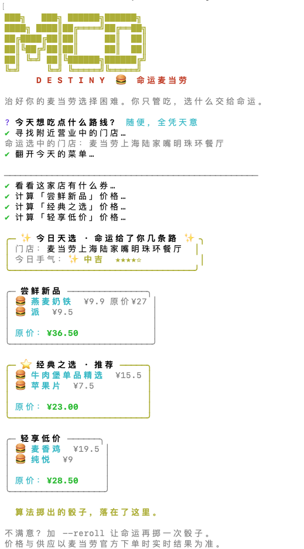
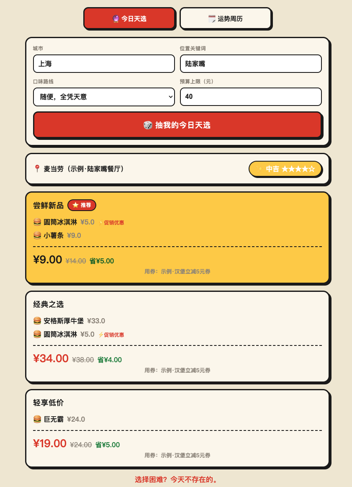
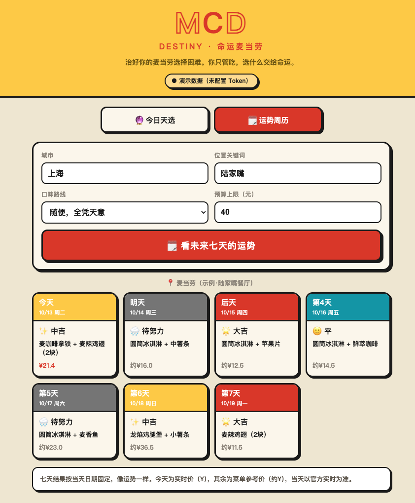

# 命运麦当劳 (mcd-destiny)

> 治好你的麦当劳**选择困难**。
> 你只管吃，吃什么交给命运——结合你的预算、口味、今天的活动和手里的券，一键甩给你今天的**天选套餐**，还顺手告诉你怎么点最省。
> 基于麦当劳中国 MCP 能力。

你有没有过这种时刻：打开麦当劳 App，盯着满屏的汉堡套餐，手指悬在屏幕上十分钟，最后还是点了跟上次一样的东西。

问题从来不是"没得选"，而是**选项太多、决策太累**。`mcd-destiny` 反其道而行——它不给你列一堆选项，而是直接替你做决定：

```
🔮 命运麦当劳 · 今日天选套餐
命运选中的门店：上海麦当劳陆家嘴前滩中心餐厅

✨ 今日天选套餐 ✨
  🍔 巨无霸  ¥24.00
  🍔 中可乐  ¥8.00

  原价：¥32.00
  用券到手：¥20.50（巨无霸优惠券）
  省了 ¥11.50

  命运已经替你选好了，别再纠结了。
```

不满意？`--reroll` 让命运再掷一次骰子。

真实运行效果（连接麦当劳 MCP 的实时门店与菜单数据）——命运给你三套算好价的方案，到手价最低的标 ⭐推荐，正在促销的商品带 ⚡ 与划线原价：

<p align="center">
  
</p>

每套方案都会实时比遍可用券、给出用券到手价（下图 🙂 平手气）：

<p align="center">
  
</p>

---

## 为什么是"命运"而不是"随机"

同一天、同样的口味和地点，`mcd-destiny` 给你的结果是**稳定的**——像每日运势一样。这背后是一个以"当天日期 + 你的输入"为种子的可复现随机算法（mulberry32），而不是每次刷新都变。这样它才有"今天就该吃这个"的仪式感，而不是让你陷入"再抽一次会不会更好"的新一轮纠结。

想主动打破命运，就加 `--reroll`。

---

## 命令一览

| 命令 | 作用 |
|---|---|
| `mcd-destiny`（默认） | **今日天选套餐**：帮你决定今天吃什么，并给出最省点法 |
| `mcd-destiny fortune` | **运势周历**：一次抽好今天/明天/后天三天的天选套餐，像翻日历一样提前安排 |
| `mcd-destiny save` | 省钱助手：手动选商品，比遍当前门店所有可用券，找最省的点法 |
| `mcd-destiny points` | 积分管家：积分余额与过期提醒、积分商城可兑换（标注够不够换）、活动日历 |
| `mcd-destiny coupons` | 领券助手：看可领券、一键领券、查卡包 |
| `mcd-destiny doctor` | 连接自检，验证 MCP Token |

主命令负责"做决定"，辅助命令负责"抠细节"——想自己掌控时，`save` 会把每张券的到手价都算给你看。

---

## 安装

需要 Node.js 18 及以上（用到原生 `fetch`）。

```bash
git clone https://github.com/zd1471278687/mcd-destiny.git
cd mcd-destiny
npm install
```

## 配置 MCP Token

1. 前往 [麦当劳 MCP 开放平台](https://open.mcd.cn/mcp) 登录并申请 MCP Token。
2. 复制 `.env.example` 为 `.env`，填入你的 Token：

   ```bash
   cp .env.example .env
   # 编辑 .env，把 MCD_MCP_TOKEN 换成你的真实 Token
   ```

   > `.env` 已在 `.gitignore` 中，不会被提交。切勿把真实 Token 写进任何会公开的文件。

3. 自检连接：

   ```bash
   node bin/mcd-destiny.js doctor
   ```

   看到 `✓ 连接成功，MCP Token 有效。` 即可。

## 使用示例

### 抽今日天选套餐（主命令）

```bash
# 全交互
node bin/mcd-destiny.js

# 或一行搞定
node bin/mcd-destiny.js --city 上海 --keyword 陆家嘴 --taste beef --budget 35

# 对结果不满意，重掷
node bin/mcd-destiny.js --city 上海 --keyword 陆家嘴 --reroll
```

参数：

- `--taste` 口味路线：`any`（随缘）/ `chicken` / `beef` / `fish` / `veggie`
- `--budget` 预算上限（元），命运会尽量不超
- `--reroll` 不按当天固定结果，重新抽
- `--city` / `--keyword` 跳过交互直接定位门店

### 运势周历：一次看好三天

```bash
node bin/mcd-destiny.js fortune --city 上海 --keyword 陆家嘴 --taste beef
```

一次性给出今天 / 明天 / 后天各一套天选套餐，每天带独立的"手气"等级（🌟大吉 / ✨中吉 / 🍀小吉 / 🙂平 / 🌧待努力），结果按当天日期固定：

<p align="center">
  
</p>

> 今天那套会实时算价，明/后天用菜单参考价（避免过度调用、也更贴近"预告"的定位）。

### 想自己抠到最省

```bash
node bin/mcd-destiny.js save --city 上海 --keyword 陆家嘴
```

### 管好积分

```bash
node bin/mcd-destiny.js points
```

---

## 工作原理

`destiny` 主命令的决策链全部基于麦当劳 MCP 的真实数据：

1. `query-nearby-stores` 找到附近**正在营业**的门店（用真实的 `businessStatus` 字段过滤）；
2. `query-meals` 拉这家店的真实菜单，并读取每件商品的 `currentPrice`/`originalPrice`/`discountInfos`，识别哪些**正在促销**；
3. 按你的**口味关键词**和**预算**过滤候选；
4. 用可复现随机抽出**三套不同风格的方案**——「尝鲜新品」（优先带促销的商品）、「经典之选」、「轻享低价」；
5. `query-store-coupons` + `calculate-price` 为**每一套**真实算出原价与最省券到手价，并排对比，**到手价最低的那套自动标 ⭐ 推荐**；
6. `campaign-calendar` 点出今天还有什么活动。

也就是说，命运不是甩给你一个答案，而是给你**几条已经算好价、标好促销的路**，推荐哪条则交给真实到手价说话。促销标记（⚡）直接来自菜单的 `discountInfos` 字段，不是我们编的。

详见 [MCP_INTEGRATION.md](./MCP_INTEGRATION.md)。

### 诚实的边界

- 价格、供应、券与活动状态一律以麦当劳官方下单时的实时结果为准，本工具输出仅供参考。
- 满减/满折规则（`query-promotions`）仅企业团餐场景可用，个人到店/外送拿不到，所以本工具不做"凑单满减"，省钱部分只做"同组合下哪张券最省"。
- 本工具**只做决策与查询，不会替你自动下单或消费积分**。

---

## 目标用户

- 每次点麦当劳都要纠结半天的"选择困难症"患者；
- 想要点餐有点仪式感和趣味、不想天天吃一样的人；
- 喜欢命令行、希望把"今天吃啥"这件小事自动化的开发者。

---

## 项目结构

```
mcd-destiny/
├── bin/mcd-destiny.js       # CLI 入口（destiny 为默认命令）
├── src/
│   ├── config.js            # 读取 .env / 环境变量里的 MCP Token
│   ├── mcpClient.js         # 轻量 MCP 客户端（Streamable HTTP + JSON/SSE/文本解析）
│   ├── format.js            # 价格换算、字段容错提取、输出样式
│   └── commands/
│       ├── destiny.js       # 【主命令】今日天选套餐：决策 + 可复现随机 + 比价
│       ├── fortune.js       # 运势周历：连抽今/明/后三天
│       ├── save.js          # 省钱助手
│       ├── points.js        # 积分管家
│       └── coupons.js       # 领券助手
├── mcp-config.example.json  # 脱敏 MCP 配置示例（仅环境变量占位符）
├── .env.example             # Token 配置模板
├── SKILL.md                 # Skill 工作流定义（能力、工具链、护栏）
├── MCP_INTEGRATION.md       # 实际使用的 MCP Server / Tool / 调用流程说明
├── workbuddy.md             # WorkBuddy 开发/使用上下文
└── CONTEST_DECLARATION.md   # 参赛声明（内容不可修改）
```

---

## 隐私与安全

- 本工具不保存、不上传你的任何个人数据，所有请求直连麦当劳官方 MCP Server。
- 决策与查询类操作均为只读；`coupons` 的"一键领券"会在确认后领券，但**不会下单、不会花你的积分**。
- MCP Token 只从环境变量 / 本地 `.env` 读取，仓库内不含任何真实凭证。

## 免责声明

本项目为麦当劳程序员节创意开发大赛参赛作品，由参赛者独立开发，非麦当劳官方产品。餐品信息、价格、券与积分状态均以麦当劳官方渠道实时结果为准，本工具输出仅供参考。

## 许可

MIT
