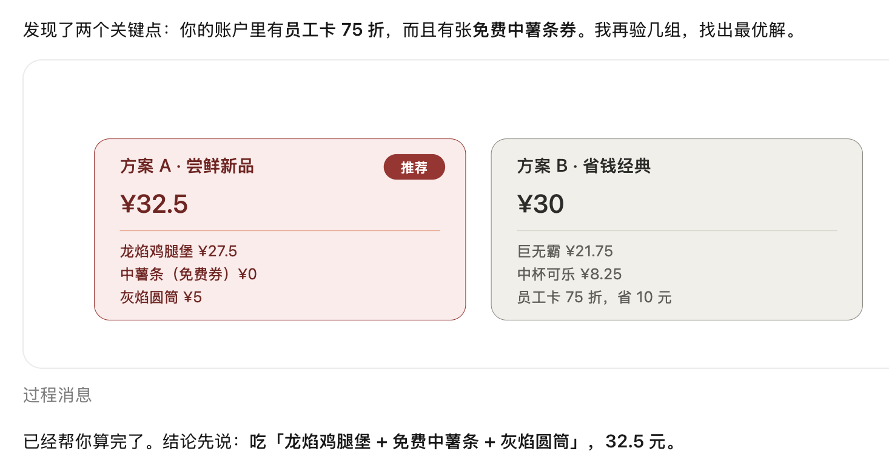
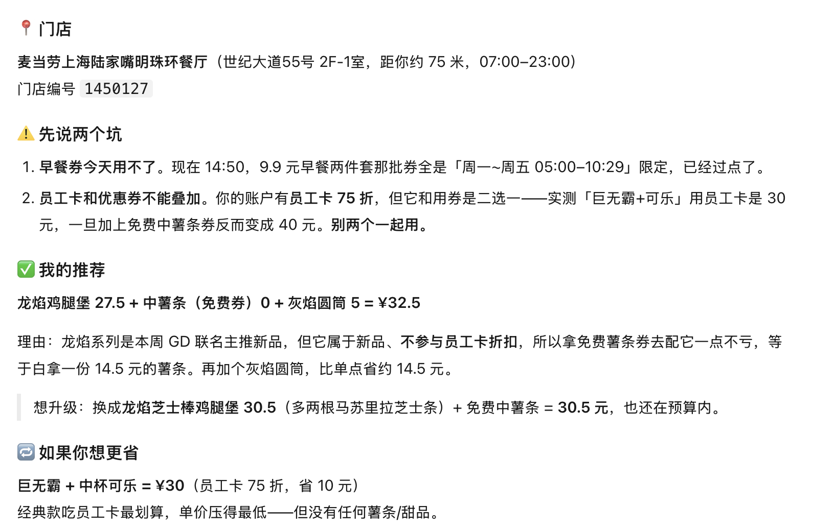

# WorkBuddy 对话上下文

> 本文件用于麦当劳程序员节创意开发大赛的 **WorkBuddy 专项奖励**联动，
> 记录本项目「命运麦当劳 (mcd-destiny)」在腾讯 WorkBuddy 中真实使用、开发与调试的对话上下文。
> 第三部分为真实运行截图及其输出要点。

## 一、使用的智能体

| 项 | 值 |
|---|---|
| 智能体 | 腾讯 WorkBuddy |
| 官网 | https://www.workbuddy.cn |
| 使用方式 | 在 WorkBuddy 中通过「自定义连接器 → 配置 MCP」接入麦当劳 MCP Server，并在对话中编排调用、辅助开发本项目 |

## 二、MCP 连接配置（WorkBuddy 连接器）

在 WorkBuddy 左侧边栏【专家·技能·连接器】→【连接器】→【自定义连接器】→【配置 MCP】中填入：

```json
{
  "mcpServers": {
    "mcd-mcp": {
      "type": "streamablehttp",
      "url": "https://mcp.mcd.cn",
      "headers": {
        "Authorization": "Bearer ${MCD_MCP_TOKEN}"
      }
    }
  }
}
```

> 仓库内 [`mcp-config.example.json`](./mcp-config.example.json) 为同一份脱敏模板，只含环境变量占位符。
> 实际使用时请在 WorkBuddy 中替换为本人 MCP Token，**Token 不写入代码、不提交仓库**。

## 三、对话上下文（真实交互截图）

### 场景：帮用户在陆家嘴决定今天吃什么、怎么点最优

**用户：**
> 又在麦当劳 App 前纠结了十分钟，帮我在上海陆家嘴决定今天吃什么，预算 40 以内，顺便告诉我怎么点最划算。

**WorkBuddy（通过 mcd-mcp 连接器编排 MCP Tools）：** 先用 `query-nearby-stores` 定位门店、`query-meals` 拉菜单，再结合账户里的优惠（员工卡 / 优惠券）用 `calculate-price` 实测多组组合，给出方案对比与推荐。

真实运行结果如下：

<p align="center">
  
</p>

<p align="center">
  
</p>

**WorkBuddy 真实输出要点（摘自上图）：**

- **门店**：麦当劳上海陆家嘴明珠环餐厅（世纪大道 55 号 2F-1 室，距约 75 米，营业 07:00–23:00），门店编号 `1450127`。
- **方案 A · 尝鲜新品（推荐）**：龙焰鸡腿堡 ¥27.5 + 中薯条（免费券）¥0 + 灰焰圆筒 ¥5 = **¥32.5**。
- **方案 B · 省钱经典**：巨无霸 + 中杯可乐，员工卡 75 折后 = **¥30**（省 10 元）。

**WorkBuddy 实测出的两条真实业务规则（很有价值的发现）：**

1. **早餐券有时段限制**：9.9 元早餐两件套券为「周一~周五 05:00–10:29」限定，当时 14:50 已过点，用不了。
2. **员工卡折扣与优惠券不能叠加，二选一**：实测「巨无霸 + 可乐」用员工卡是 30 元，一旦再叠加免费中薯条券反而变成 40 元——两个不能一起用。

### 这些真实发现对本项目的意义

上面这段 WorkBuddy 对话帮我验证并厘清了麦当劳在**个人到店场景下的真实计价规则**：优惠不可叠加、新品不参与会员折扣、券有时段限制。这印证了本项目在 `README.md` / `MCP_INTEGRATION.md` 中说明的边界——`mcd-destiny` 的省钱部分只做"同一组合下哪张券最省"的逐张试算（基于 `calculate-price` 的真实返回），而不臆造"叠加凑单"的省法。

### 开发与调试过程中的关键对话

- **需求澄清**：把痛点从"太贵"重新定位为"选择困难"，确定主命令是"替用户做决定"而非"列一堆选项"。
- **真实字段核对**：在 WorkBuddy 里调用 `query-my-account` / `mall-points-products` / `query-nearby-stores`，确认真实字段名（`availablePoint`、`currentMouthExpirePoint`、`spuName`、`point`、`storeCode`、`businessStatus` 等），据此编码而非凭文档猜测。
- **返回形态兼容**：发现 MCP 返回有三种形态（纯 JSON / 文字+JSON 混排 / 纯 Markdown，如 `available-coupons`、`campaign-calendar`），据此在 `src/mcpClient.js` 做括号配对抽取 JSON + 文本兜底。
- **业务错误处理**：遇到 `success:false, code:508`（太火爆了）时确认需按业务错误抛出提示，不能当成空数据。
- **边界确认**：确认满减/满折 `query-promotions` 仅企业团餐 `beType=6` 可用，个人场景不做"凑单满减"，省钱只做"同组合下哪张券最省"。
- **可复现随机**：讨论用 mulberry32 + 日期种子实现"每日运势"般的确定性，避免用户反复 reroll 陷入新的纠结。

## 四、声明

- 本项目在 WorkBuddy 中**真实使用**：通过其自定义连接器接入麦当劳 MCP Server，完成数据查询、Skill 编排与开发调试。
- 本文件所记录交互为真实开发/使用场景的提炼，不含任何真实 Token、手机号等敏感信息。
- 本项目为 2026 麦当劳程序员节创意开发大赛参赛作品，非麦当劳官方产品。
